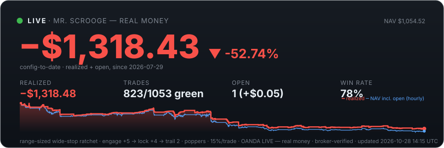
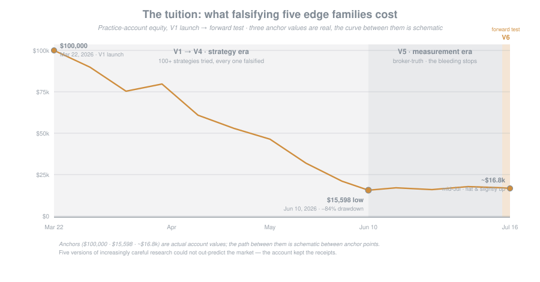
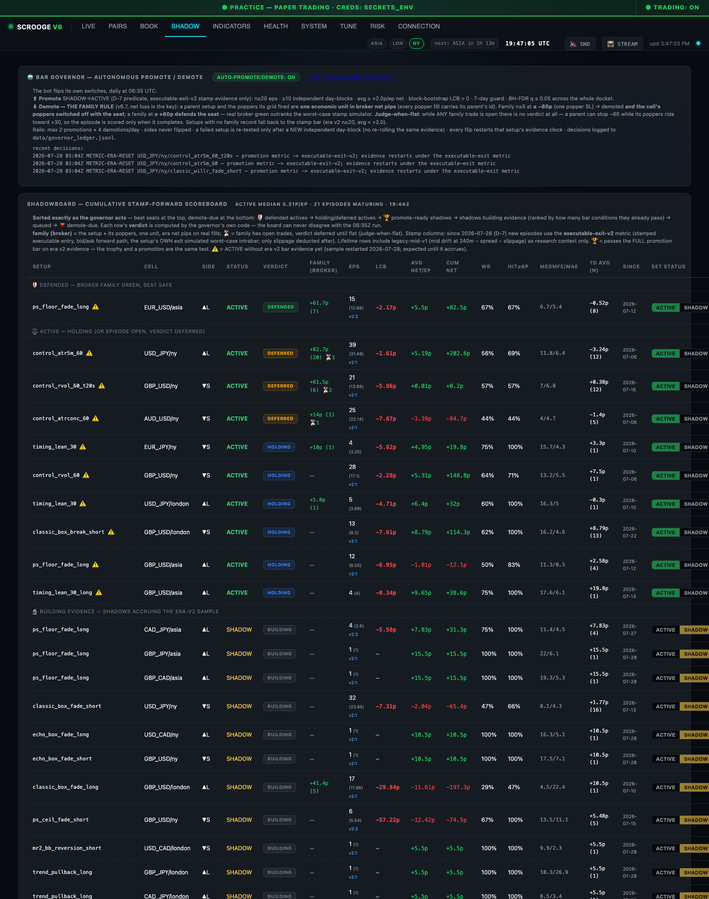

<div align="center">

# Mr. Scrooge V6

### A forex bot that puts strategies on trial, and keeps only the ones that win with real money.

*An open-source **Python** trading bot for **OANDA**, trading a **real-money account** since 2026-07-29. About 1,600 mechanical setups stamp live markets as zero-risk shadows across 18 pairs. A setup holds a live seat only while **its own broker fills** keep up with the standard set by the bot's best live performers. The record below is broker-verified and updates every hour.*

 &nbsp;  &nbsp; [](https://github.com/BrockStar3540/mr-scrooge-v6/actions/workflows/tests.yml) &nbsp; [](#how-a-setup-keeps-its-seat) &nbsp; [](docs/FORWARD_TEST_100_REPORT.md)

</div>

<!-- LIVE_BALANCE_START -->
<div align="center">

 -f85149?style=flat-square)  -58a6ff?style=flat-square)

[](livelog/trades.csv)

</div>

#### Win rate: all-time vs. recent

| Window | Trades | Win rate | vs all-time | Net P/L |
|---|---:|---:|---:|---:|
| **All-time** | 1113 | **78.1%** | — | −$1,370.95 |
| Last 90 days | 1034 | **78.7%** | ▲ +0.6 pts | −$1,170.37 |
| Last 60 days | 730 | **76.4%** | ▼ −1.6 pts | −$957.33 |
| Last 30 days | 365 | **74.2%** | ▼ −3.8 pts | −$169.07 |
| Last 15 days | 164 | **72.0%** | ▼ −6.1 pts | −$183.67 |
| Last 7 days | 98 | **74.5%** | ▼ −3.6 pts | −$88.57 |

<sub>Every closed live trade (parents + poppers); a win = realized P/L > 0. Windows count back from 2026-10-31 00:15 UTC by close time; refreshed hourly with each new close.</sub>

> **🔴 REAL-MONEY track record** — $2,500 live stake since 2026-07-29, cut over after the [100-trade practice test](docs/FORWARD_TEST_100_REPORT.md) (+10.54%, pre-registered protocol). range-sized wide-stop ratchet · SL 40/50/60 · two-phase: engage +5 → lock +4, steps +7/+9/… → lock −2 + Party Package popper grids · 15%/trade · 6 max (424 popper trades in the record), auto-updated hourly from **broker-verified fills** ([trades](livelog/trades.csv) · [equity](livelog/equity.csv)). Small sample, honest record — some trades sit red for days under the wide stops before exiting green; that is the design, not a malfunction. Prior configs and the −84% research tuition: [the history](docs/SCROOGE_HISTORY.md). The concluded practice record is archived at [forward-test-100/](https://github.com/BrockStar3540/mr-scrooge-v6/tree/main/forward-test-100).
<!-- LIVE_BALANCE_END -->

---

## What's running now

*As of 2026-10-28. Live statuses sit in [`config/cells/`](config/cells), and every seat change is in the governor ledger.*

| | |
|---|---|
| **Account** | OANDA live, $2,500 stake since 2026-07-29; NAV about $1,055 on 2026-10-28 (every trade in [`livelog/`](livelog/)). The 100-trade practice test ended at +10.54% and set up the cutover ([report](docs/FORWARD_TEST_100_REPORT.md)). |
| **Book** | 18 pairs × 3 sessions (Asia, London, New York). 1,715 setups: 1,621 stamp as shadows, 77 are retired. **14 ACTIVE + 3 PROBE** hold live seats. |
| **Entries** | A seat trades only when its setup fires: explicit, mechanical conditions on standard indicators. No setup, no trade. |
| **Exit** | Server-side stop of 40 / 50 / 60 pips, sized to the session's typical swing. Two-phase ratchet: at +5 it locks +4, then every +2 it steps up to lock peak −2 (+7 locks +5, +9 locks +7). No take-profit and no timeout. |
| **Poppers** | Each parent hangs a grid of same-direction add-on trades at 25 / 35 / 45 / 55 pips adverse. Each has its own 60p stop and the same ratchet. Grids fire only while the book holds fewer than 4 trades, and they retire when the parent closes. |
| **Risk** | 20% of balance in margin per trade (PROBE seats 0.20×). Max 8 open trades, max 4 per currency direction, 160% total margin budget. The reaper closes any trade still red after 4 hours (since 2026-10-28; it was 24 hours). |
| **Public data** | Every live trade with entry, stop and exit ([`trades_detail`](livelog/detail/trades_detail_2026-10-28.csv)); the raw OANDA exports of the [live](livelog/detail/oanda_live_transactions_2026-02-21_to_2026-10-28.csv) and [practice](livelog/detail/oanda_practice_transactions_2026-02-21_to_2026-07-28.csv) accounts; every simulated shadow episode ([registry](research/registry/README.md)). |

## How a setup keeps its seat

**The standard, live since 2026-10-21.** The earlier governor promoted and demoted on simulated results. The simulation didn't match real trading:
- Across the 75 setups with both simulated and real cycles, the correlation between them was **0.07**.
- The two agreed on whether a setup made money **37 times out of 75**.
- The simulation never showed the deep losing cycles that cost real money.

So seats are now judged **only on their own broker fills**. The yardstick is the profile of the five best live setups:

| Top-5 live profile (real fills) | |
|---|---|
| win rate | 85–96% |
| pips per cycle | +7 to +15 |
| profit factor | 2.7 or better |
| worst cycle | no deeper than one stop (−60p) |
| losses | 1.5 or fewer per 10 cycles |

A **cycle** is a parent plus the poppers its grid fired, scored as one unit in broker net pips. Every hour, each seat is scored on its last 20 cycles:

| | rule |
|---|---|
| **Stay** (judged at 10+ cycles) | ≥ 80% wins, ≥ +3 pips/cycle, profit factor ≥ 1.5, no cycle worse than −90p |
| **Graduate** PROBE → ACTIVE (10+ cycles) | ≥ 85% wins, ≥ +5 pips/cycle, profit factor ≥ 2.5, worst cycle ≥ −65p (the top-5 profile) |
| **Tripwire** | any cycle worse than −90p demotes at once, at any sample size |
| **Probe limit** | a PROBE that reaches 20 cycles without the standard goes back to shadow |
| **Auditions** | up to 3 shadows at a time audition as 0.20× PROBEs. The simulator only orders the queue, and a setup's own past real fills veto it. |
| **Three strikes** | every demotion is a permanent strike, and the third retires the setup to DISABLED |

**Why cycles, not days.** A top setup fires 2–3 cycles a week, so ten days is only 3–4 cycles. One normal stop in 4 cycles would fail a genuine 90% setup about a third of the time. Twenty cycles at an 80% floor misjudges it about 4% of the time. The great ones still lose; the standard scores how often, how much, and what they net.

Code: [`ops/standard.py`](ops/standard.py) (scoring), [`ops/governor.py`](ops/governor.py) (runs hourly at :35Z). Each decision is written to the governor ledger with its numbers, and machine-written seat changes are committed to this repo hourly at :20.

## How we got here



- **The tuition, V1 to V4 (Mar–Jul 2026).** A $100,000 practice account fell to **$15,598, −84%**. Five versions of increasingly careful research couldn't out-predict the market: entry features predicted *when* and *how far* price moves, never *which way* (0 of 144 feature×cell combinations carried direction). The complete raw broker export, 11,564 transactions, is public in [the archive](https://www.dropbox.com/scl/fo/uyjwoj274ndzqg98ol72p/AEB6zn4q-jFexhZxVmYFRyc?rlkey=a06ocaqxuyz4at1dfkjmww1i9&st=kup4s0x9&dl=0) under `proof-of-tape/`.
- **V5 and V6, the measurement turn.** Broker fills became the only truth. Wide stops replaced a survivorship-biased tight-stop dial-in, and every strategy became a shadow that had to earn a seat.
- **The 100-trade practice test (2026-07-16 → 07-29).** $16,665 → $18,421, **+10.54%, 90 wins / 10 losses**, pre-registered endpoint ([protocol](docs/FORWARD_TEST_PROTOCOL.md), [report](docs/FORWARD_TEST_100_REPORT.md), [tape](forward-test-100/)). As registered, the same code went live with $2,500.
- **Live (07-29 →).** An autonomous governor promoted and demoted on simulated evidence, and the live account drew down; the record above shows every trade. On 10-12 the book was cut to its proven seats. On 10-21 the simulator lost its vote: the seats became every setup at **85%+ cycle wins with positive pips over 5+ real cycles**, plus three practice-test winners that had never traded live, and the broker-truth standard took over. On 10-28 the ratchet was tightened to lock +4 at +5 (parents and poppers; poppers had never actually had the early lock) and the reaper went from 24 hours to 4: we're back to dialing in the exit ([6.31.0](CHANGELOG.md)).

Every version, the edge hunt and the wide-stop turn: [History V1→V6](docs/SCROOGE_HISTORY.md). Every defect and dead end, on purpose: [Book of Bugs](docs/BOOK_OF_BUGS.md) (B-001 → B-145).

## What we falsified

On retail OANDA majors, no price-*prediction* edge cleared cost ([paper](docs/papers/PAPER_edge_hunt_falsifications_2026-07-14.md)). Where later findings overturned our own numbers, the errata ship inside the archived originals.

| edge family | verdict |
|---|---|
| M5 scalping | edge ≈ its own transaction cost |
| Single-pair daily trend | a coin flip |
| Diversified retail TSM | real, but net Sharpe −0.22 on our venue |
| Symmetric straddle | you always own the loser |
| Tight-stop-and-reverse | the "asymmetry" was realized direction |
| Tight stop dialed to winners' MAE | survivorship-biased, so we moved to the wide-stop book |
| Wide-stop book (pre-registered walk-forward) | gross Sharpe 1.26, **net 0.03**: the edge equals the toll ([paper](docs/papers/PAPER_h6_walkforward_2026-07-16.md)) |
| Popper grids (10 rounds) | the gross harvest is real; the toll is bigger in simulation ([paper](docs/papers/PAPER_party_package_scale_in_2026-07-19.md)) |
| Simulator-scored promotion | per-setup correlation with real fills 0.07; replaced by the broker-truth standard (2026-10-21) |
| The old evidence bar, deflated | median deflated Sharpe 0.00: its selection measured the search ([issue #9](https://github.com/BrockStar3540/mr-scrooge-v6/issues/9), [registry](research/registry/README.md)) |

## Red for hours, not days

The stops are wide and there is no take-profit, so a trade can sit red until its move develops, the ratchet engages, and it exits green. Since 2026-10-28 the 4-hour reaper cuts any trade still red after 4 hours (it was 24 hours, and before 10-01 it was 72). The winners are many and small, the losers rare and large. That is why the standard scores loss size and loss frequency, not win rate alone.

## The dashboard

A local control panel (`127.0.0.1:8084`; set `DASHBOARD_HOST` to [bind elsewhere](docs/DASHBOARD.md)). It shows the live account and open trades, the cell book with every setup's status and broker record, live exit tuning, popper switches, the trading pause, and `/signals`: a manual-trading watch page that grades its own calls against forward price.



## Read the research

| | |
|---|---|
| 📖 **[Strategy Book](docs/STRATEGY_BOOK.md)** | all 40 strategy families: what each trades, the indicators it reads, what the backtesting said, and how it did with real money |
| 🧭 **[Research Program](docs/RESEARCH_PROGRAM.md)** | the falsification method and open dockets |
| 🤖 **[Governor](docs/GOVERNOR.md)** | the promote/demote machinery, the rails, the ledger, the switches |
| 🧮 **[Hypothesis registry](research/registry/README.md)** | every setup ever scored and every decision, refreshed hourly, plus the [deflated Sharpe / PBO test](research/deflation/PREREGISTRATION.md) |
| 📜 **[History V1→V6](docs/SCROOGE_HISTORY.md)** | every version, the edge-hunt arc, the survivorship turn |
| 🗃️ **Code history V1–V5** | full git history of every retired version, secret-redacted: [V1+V2](https://github.com/BrockStar3540/mr-scrooge-v1) · [V3](https://github.com/BrockStar3540/mr-scrooge-v3-archive) · [V4](https://github.com/BrockStar3540/mr-scrooge-v4-archive) · [V5](https://github.com/BrockStar3540/mr-scrooge-v5-archive) |
| 🐛 **[Book of Bugs](docs/BOOK_OF_BUGS.md)** | B-001 → B-145 |
| 📄 **[Papers](docs/papers/)** | the full paper index |
| 🔬 **[Research & data index](research/README.md)** | corpora, retired modules, the strategy graveyard |
| 📦 **[The Archive](https://github.com/BrockStar3540/mr-scrooge-archive)** | papers, session notes, backtests with errata, and `proof-of-tape/` Moved to GitHub 2026-10-28; corpora are [release downloads](https://github.com/BrockStar3540/mr-scrooge-archive/releases/tag/research-corpora-2026-07-29); [Dropbox mirror](https://www.dropbox.com/scl/fo/uyjwoj274ndzqg98ol72p/AEB6zn4q-jFexhZxVmYFRyc?rlkey=a06ocaqxuyz4at1dfkjmww1i9&st=kup4s0x9&dl=0). |
| ⚙️ **[Setup](docs/SETUP.md)** | install from zero on an OANDA **practice** account |
| 🤝 **[Contributing](CONTRIBUTING.md)** | outside ideas welcome, through the same gauntlet ours face |

## ☕ Support this work

Built in the open over hundreds of hours and millions of paid AI-coding tokens, with no fund or company behind it, just one person putting the whole thing out there, losses and all. If it taught you something, [buy me a coffee](https://buymeacoffee.com/BrockStar3540).

[](https://buymeacoffee.com/BrockStar3540)

---

> ⚠️ **This bot trades real money, and its live record is shown above as it stands. Not financial advice. Leveraged forex can lose more than your deposit. If you run this, the outcomes are yours.**

## Development

V6 is the live trader. Since cutover, changes are fixes and seat-policy changes, each recorded in the Book of Bugs or the governor ledger. New strategy machinery goes to **Mr. Scrooge V7**.

**The pipe guard (required for contributors), once per clone:**

```
git config core.hooksPath ops/hooks
python3 -m venv --system-site-packages .venv-test
.venv-test/bin/pip install -r requirements-dev.txt
```

Every `git push` runs the full suite twice (fixed and randomised order, matching CI) plus a secrets sweep, and blocks on any failure. Pushes that touch only `livelog/` or `README.md` skip the suite but keep the sweep. `git push --no-verify` bypasses it, deliberately and visibly ([B-111](docs/BOOK_OF_BUGS.md), [B-118](docs/BOOK_OF_BUGS.md), [B-123](docs/BOOK_OF_BUGS.md)).
